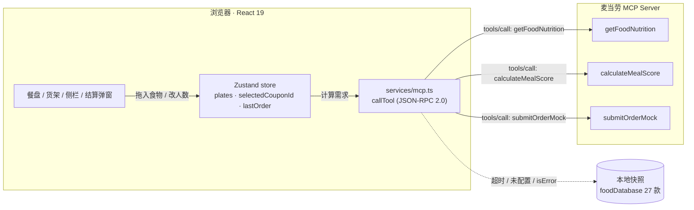
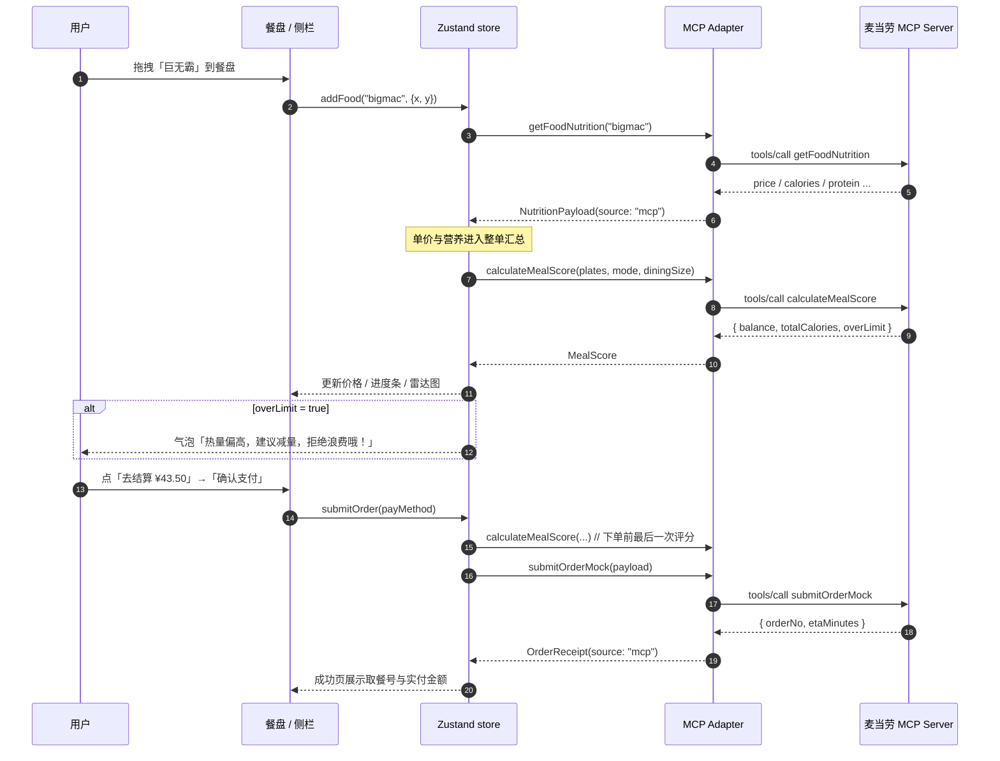

# MCP 集成说明 · MCP Integration

> 麦当劳 WorkBuddy 开发者挑战赛 · 核心得分点
> 代码实现：[`src/services/mcp.ts`](./src/services/mcp.ts) · 配置样例：[`mcp-config.example.json`](./mcp-config.example.json)

## 一、为什么需要 MCP

营养与价格是这个应用的地基：模式推荐、均衡评分、热量预警、优惠券门槛、结账金额，全部由它们推导。把这些数据写死在前端有两个问题——菜单一变就要发版，不同门店/时段的差异也无从体现。

因此项目把「取数」收敛成一个出口：**所有营养、评分、下单请求都走 MCP Tool**。前端只负责交互与呈现，数据由 Server 提供；Server 不可用时降级到本地快照，保证演示永远能跑通。

## 二、架构



## 三、Tool 清单

| Tool | 触发时机 | 入参 | 出参关键字段 |
|---|---|---|---|
| `getFoodNutrition` | 菜单加载、加入餐盘时校验 | `foodId`, `locale` | `name` `price` `calories` `protein` `fat` `carbs` |
| `calculateMealScore` | 餐盘变化、结算前 | `modeId`, `diningSize`, `items[{foodId,qty}]` | `health` `variety` `balance` `totalCalories` `perPersonCalories` `overLimit` |
| `submitOrderMock` | 点击「确认支付」 | `items` `payable` `discount` `originalPrice` `diningSize` `payMethod` `modeId` | `orderNo` `payable` `itemCount` `etaMinutes` |

请求统一按 MCP 规范封装（`tools/call`）：

```json
{
  "jsonrpc": "2.0",
  "id": 1,
  "method": "tools/call",
  "params": {
    "name": "getFoodNutrition",
    "arguments": { "foodId": "bigmac", "locale": "zh-CN" }
  }
}
```

响应优先读 `result.structuredContent`，缺失时回退解析 `result.content[0].text` 的 JSON：

```json
{
  "jsonrpc": "2.0",
  "id": 1,
  "result": {
    "structuredContent": {
      "foodId": "bigmac",
      "name": "巨无霸",
      "price": 25.5,
      "calories": 513,
      "protein": 27,
      "fat": 26,
      "carbs": 42
    }
  }
}
```

## 四、一次完整调用的时序

以「拖一份巨无霸进餐盘 → 触发防浪费 → 结账」为例：



## 五、代码映射

| 前端行为 | 代码位置 | 说明 |
|---|---|---|
| 建立 Tool 调用通道 | `mcp.ts › callTool()` | JSON-RPC 2.0，4s 超时，`Authorization: Bearer ${token}` |
| 单餐品营养 | `mcp.ts › getFoodNutrition()` | 失败回落到 `foodDatabase`，`source: "local"` |
| 整单评分 | `mcp.ts › calculateMealScore()` | 与侧栏同一口径：热量上限来自 `nutritionTargets()`（每人 1000 kcal） |
| 下单 | `mcp.ts › submitOrderMock()` | 本地降级时保留 1.25s 往返节奏，支付动画不突兀 |
| 结算编排 | `useTrayStore.ts › submitOrder()` | 先评分再下单，回执带 `plateCount` 与 `balance` |
| 数据来源标识 | `StatsPanel.tsx` | 侧栏底部实时显示「MCP 实时数据 / 本地营养库」 |

```ts
// useTrayStore.ts › submitOrder：先让 Server 评分，再下单
const score = mode
  ? await calculateMealScore(plates, mode, diningSize).catch(() => null)
  : null;

const receipt = await submitOrderMock({
  items: [...qty].map(([foodId, count]) => ({ foodId, qty: count })),
  payable: bill.payable,
  discount: bill.discount,
  originalPrice: bill.original,
  diningSize,
  payMethod,
  modeId: mode?.id ?? "taste",
});

set({ lastOrder: { ...receipt, plateCount: bill.plateCount, balance: score?.balance ?? null } });
```

> 关键取舍：评分失败**不阻断**下单（`.catch(() => null)`）。营养是增强项，结账是主链路，
> 不能让一次 Tool 超时把用户卡在支付页。

## 六、降级与容错

| 场景 | 表现 | 用户感知 |
|---|---|---|
| 未配置 `VITE_MCD_MCP_URL` | 直接用本地快照，`source: "local"` | 侧栏标注「本地营养库」，功能完整 |
| 请求超时（> 4s） | 中止请求，回落本地 | 无阻塞，无报错弹窗 |
| HTTP 非 2xx / JSON-RPC `error` | 同上 | 同上 |
| `result.isError === true` | 同上 | 同上 |
| 下单失败（空订单 / 服务异常） | 抛错，弹窗停留在确认态可重试 | 提示「餐盘还是空的」等具体原因 |

所有降级都在适配层内部完成，**UI 不需要写 try/catch 分支**，只读 `source` 做标注。

## 七、配置方式

### 1. 前端（.env）

```bash
cp .env.example .env
```

```dotenv
VITE_MCD_MCP_URL=https://mcp.example.com/mcd
VITE_MCD_MCP_TOKEN=<your-token>
```

### 2. MCP 客户端（mcp-config.example.json）

仓库提供了两种传输方式的样例，按运行环境二选一：

- **HTTP（推荐，前端直连）**：`type: "http"` + `url` + `headers`
- **stdio（本地起进程）**：`command: "npx"` + `args` + `env`

所有敏感值均为 `${VAR}` 占位符，**仓库内不存在真实密钥**。

```json
{
  "mcpServers": {
    "mcdonalds-menu": {
      "type": "http",
      "url": "${MCD_MCP_URL}",
      "headers": { "Authorization": "Bearer ${MCD_MCP_TOKEN}" }
    }
  }
}
```

## 八、业务价值

**1. 点餐体验：从「看列表」到「摆餐盘」**
营养与价格实时联动，用户不必心算。拖入即算，删除即回滚，价格与热量永远同步。

**2. 减少食物浪费：把「吃不完」提前到下单前**
阈值按就餐人数动态计算（每人 1000 kcal），超限立刻提醒并给出超出量；多餐盘按人分盘，
避免「点多了没人吃」。假设每单因此少点 1 份小吃（约 ¥12），一家日单 500 的门店，
一年可减少约 180 万元级别的无效出餐与相应食材损耗。

**3. 精准健康管理：把营养标签变成可操作的搭配**
四维进度条 + 五轴雷达 + 均衡评分（结构 45 / 热量 20 / 蛋白 20 / 模式匹配 15），
用户能看懂「差在哪、怎么补」。对健身人群，营养模式直接给出高蛋白起手套餐。

**4. 对平台：菜单即服务**
价格与营养由 Server 统一供给，改菜单、调价、区域差异无需前端发版；`source` 字段让
「实时 / 快照」对用户透明，避免数据陈旧引发的信任问题。

## 九、安全与隐私

- 令牌只从环境变量读取，`.env` 已被 `.gitignore` 忽略；仓库配置文件中全部是 `${VAR}` 占位符；
- 前端不接触用户身份信息，订单只提交餐品 id 与数量，不含姓名、手机号、地址；
- `submitOrderMock` 明确为演示 Tool，不产生真实交易；
- 请求带 4s 超时，避免异常 Server 拖垮交互；
- 错误信息只写控制台，不把原始响应渲染到界面。

## 十、后续可扩展的 Tool

| Tool（设想） | 价值 |
|---|---|
| `searchMenu(query)` | 关键词 / 过敏原过滤，替代前端全量菜单 |
| `getStoreInventory(storeId)` | 售罄置灰，避免「点了才发现没有」 |
| `estimateWaitTime(storeId)` | 取餐时间更准，支撑「稍后取」 |
| `getCouponList(userTier)` | 券从 Server 下发，替代当前本地 5 张 |
| `submitOrder`（真实） | 接支付与门店系统，替换 mock |

## 十一、如何验证本项目的 MCP 行为

```bash
# 1. 不配置 MCP：确认降级路径可用
npm run dev
#   侧栏底部应显示「MCP 未接入 · 使用本地营养库」

# 2. 配置一个本地假 Server（返回固定 JSON），确认走真实分支
#   任意 HTTP 服务，对 tools/call 返回 {"jsonrpc":"2.0","id":1,"result":{"structuredContent":{...}}}
VITE_MCD_MCP_URL=http://127.0.0.1:8787/mcp npm run dev
#   侧栏底部应变为「MCP 实时数据」

# 3. 断开 Server（或填一个不可达地址），确认 4s 内回落且界面不卡死
```

自动化验收脚本：[`scripts/drive_checkout.py`](./scripts/drive_checkout.py)（选券 → 结算 → 支付 → 成功全流程，含截图）。
