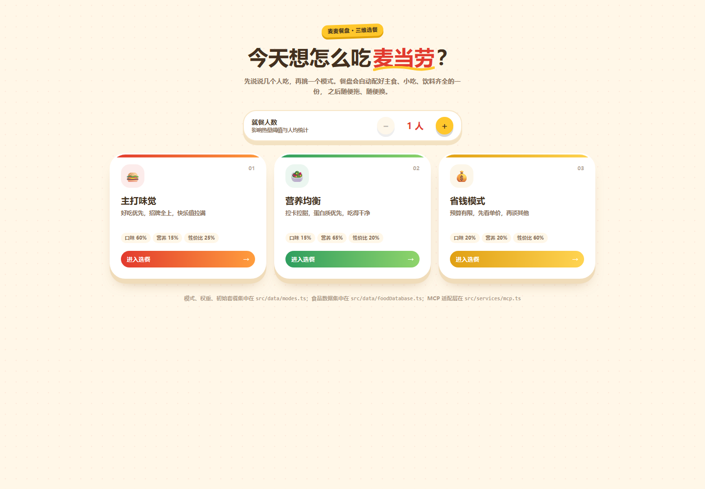
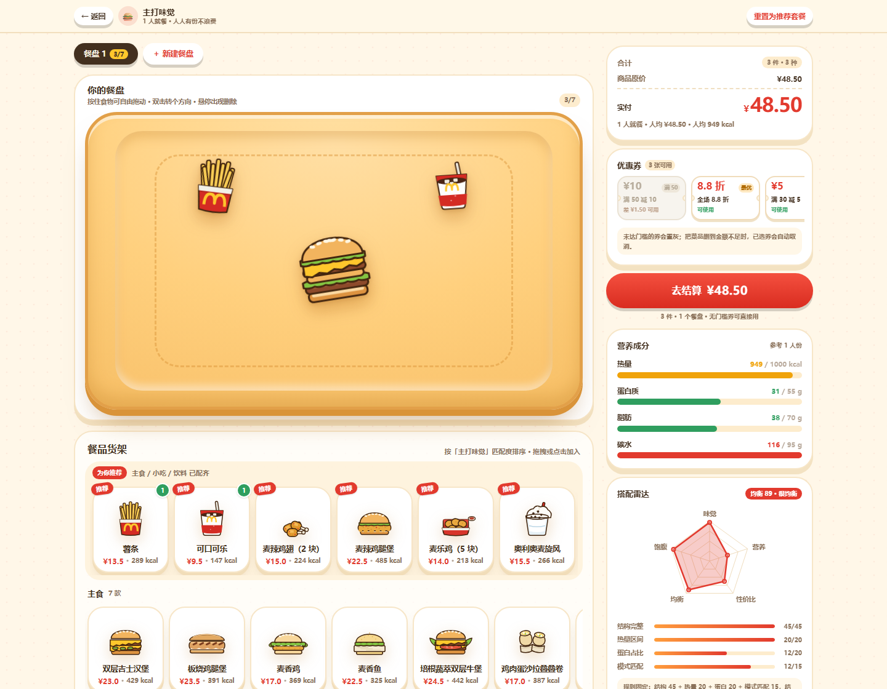
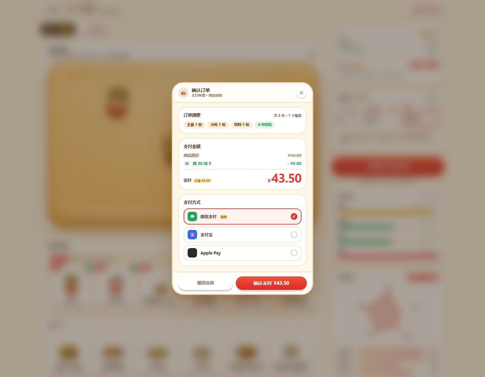
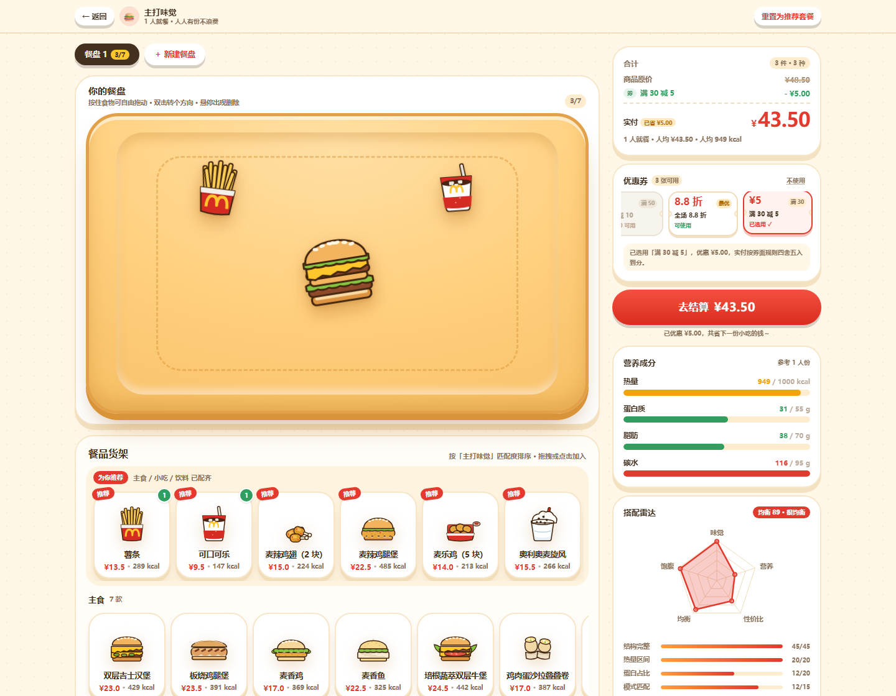
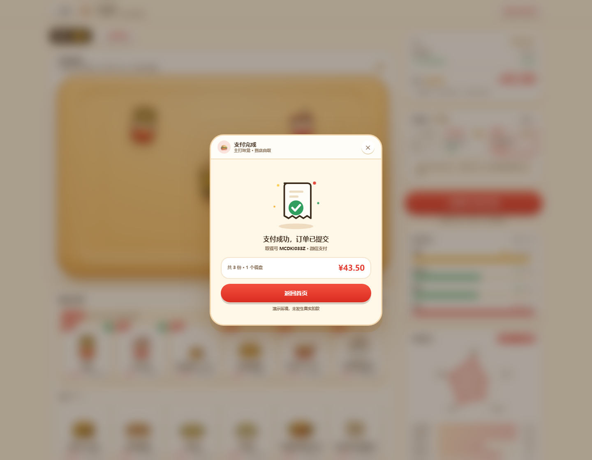
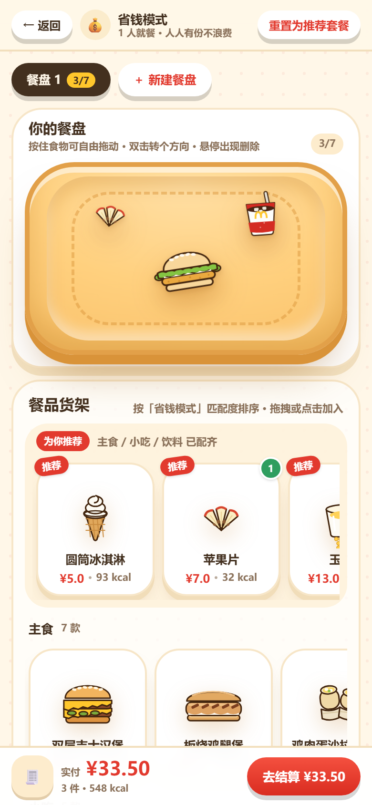

<div align="center">

# 麦麦餐盘 · McD Tray

**把麦当劳点单变成「拖拽摆盘」：三种模式自动配餐，拖进餐盘就实时算出价格、营养与浪费预警，选券结账一条龙。**

[](https://react.dev)
[](https://www.typescriptlang.org)
[](https://vite.dev)
[](https://tailwindcss.com)
[](https://zustand.docs.pmnd.rs)
[](./MCP_INTEGRATION.md)
[](./scripts/lint-data.mjs)
[](./LICENSE)

麦当劳 WorkBuddy 开发者挑战赛 · 参赛作品

</div>

---

## 这是什么

传统点单页是「一列卡片 + 一个购物车」，用户只能看到价格，看不到**这顿饭长什么样、够不够吃、会不会浪费**。

麦麦餐盘把餐盘搬进网页：食物是透明背景的卡通插画，可以**自由拖动、双击旋转、单独删除**；右侧同步算出折后价格、四维营养、均衡评分；热量超过「人数 × 1000 kcal」时弹出防浪费气泡。三种模式（味觉 / 营养 / 省钱）各自有一套权重与初始套餐，进入即可开吃，也可以从零搭配。

| | |
|---|---|
| **前端** | React 19 · TypeScript strict · Vite 7 · Tailwind CSS v4 · Framer Motion · Zustand · Recharts |
| **AI 集成** | 麦当劳 MCP Server（`getFoodNutrition` / `calculateMealScore` / `submitOrderMock`），未配置时自动降级本地数据 |
| **数据** | 27 款餐品 · 27 张专属插画（一 id 一图，构建期断言）· 5 张优惠券 |
| **体积** | CSS 36.7 kB（gzip 7.5 kB）；JS 728 kB 拆 3 包：主包 272 kB / charts 295 kB / motion 161 kB（gzip 合计 ≈ 230 kB） |

## 界面

| 首页 · 选人数与模式 | 选餐 · 拖拽摆盘 | 结算 · 优惠与支付 |
|:---:|:---:|:---:|
|  |  |  |
| 三张模式卡，权重一眼可见 | 餐盘居中，货架在左，营养在右 | 原价 / 优惠 / 实付 + 三种支付 |

| 优惠券（未达门槛置灰） | 支付成功 | 移动端 |
|:---:|:---:|:---:|
|  |  |  |

> 更多截图见 [`public/screenshots/`](public/screenshots)：营养模式、热量预警、删菜自动摘券、支付中、移动端结算。

## 目标用户

| 人群 | 痛点 | 这个项目怎么解决 |
|---|---|---|
| **减脂 / 健身人群** | 只知道「高蛋白」，不知道具体点了多少克 | 营养模式按蛋白质优先配餐，侧栏四维进度条 + 雷达图实时反馈 |
| **注重健康的上班族** | 午餐随便点，热量超了也没感觉 | 热量上限按就餐人数计算，超标立刻气泡提醒并给出超出量 |
| **多人聚餐 / 帮同事带饭** | 几个人吃、谁吃什么，全靠脑子记 | 人数步进器影响推荐与阈值；多餐盘按人分盘，互不干扰 |
| **学生 / 价格敏感用户** | 优惠券门槛算不清，凑单靠猜 | 省钱模式优先性价比；券卡置灰并标注「差 ¥X 可用」 |
| **想「先看看再点」的人** | 图文不符，点到的和想的不一样 | 27 款餐品 27 张专属插画，图文强绑定 + 构建期断言 |

## 三个核心使用流程

**① 切换「营养均衡」模式，看它自动配一餐**

1. 首页点「营养均衡」→ 餐盘自动摆上高蛋白组合（板烧鸡腿堡 + 玉米杯 + 纯牛奶）；
2. 右侧「蛋白质」进度条按人均目标推进，雷达图五轴同时变化；
3. 顶部把人数从 1 调到 2，热量上限翻倍、人均指标重算，推荐套餐不变但阈值更宽松。

**② 往餐盘里拖两份汉堡，观察满载与实例化**

1. 从货架把「巨无霸」拖到餐盘任意位置，松手处落盘并弹跳一下；
2. 再点一次卡片，盘里出现**第二个独立的巨无霸**（不是 `×2` 角标），可分别拖动、旋转、删除；
3. 放到第 7 件时提示「餐盘快满了」，第 8 件被拦下并给「＋ 新建餐盘」，新建后自动切到空盘。

**③ 加量到热量超标，再用券结账**

1. 连续加两份薯条 + 可乐，热量超过 `人数 × 1000`，侧栏顶部弹出「当前热量偏高，建议适量减量，拒绝浪费哦！」并显示超出多少；
2. 选「满 30 减 5」，实付从 ¥48.50 变 ¥43.50；删掉薯条和可乐后金额跌到 ¥25.50，券**自动失效**并提示「还差 ¥4.50 才能用…已为你取消」；
3. 点「去结算 ¥43.50」→ 确认订单（摘要 / 金额 / 微信·支付宝·Apple Pay）→ 确认支付 → 1.5s Loading → 支付成功页显示取餐号，返回首页清空整单。

## 快速开始

```bash
git clone https://github.com/nahidapc/mcd-tray-app.git
cd mcd-tray-app
npm install
npm run dev        # http://127.0.0.1:5173
```

```bash
npm run build      # tsc --noEmit && vite build
npm run preview    # 预览构建产物
npm run lint:data  # 图文绑定 / 数据完整性自检（CI 可直接用）
npm run typecheck  # 仅类型检查
```

可选：接真实 MCP Server（不配也能跑，自动用本地营养库）

```bash
cp .env.example .env
# 填入 VITE_MCD_MCP_URL / VITE_MCD_MCP_TOKEN 后重启 dev server
```

路由用查询参数，无需额外 router：

| 地址 | 页面 |
|---|---|
| `/` | 首页（就餐人数 + 三种模式） |
| `/?mode=taste` | 味觉模式（好吃优先） |
| `/?mode=nutrition` | 营养模式（蛋白优先） |
| `/?mode=value` | 省钱模式（性价比优先） |

## MCP 集成

前端所有营养/价格/下单都经过 [`src/services/mcp.ts`](src/services/mcp.ts) 一个出口，三个 Tool 一比一映射：

| Tool | 触发时机 | 作用 |
|---|---|---|
| `getFoodNutrition` | 菜单加载 / 加入餐盘 | 返回单价与蛋白质、脂肪、碳水、热量 |
| `calculateMealScore` | 每次餐盘变化、结算前 | 整单健康度、丰富度、均衡分、是否超限 |
| `submitOrderMock` | 点击「确认支付」 | 生成订单号与预计取餐时间（演示不扣款） |

```ts
// 用户拖入食物 → 前端调用 Tool → 用返回值算总分 → 触发防浪费
const score = await calculateMealScore(plates, mode, diningSize);
if (score.overLimit) pushToast("当前热量偏高，建议适量减量，拒绝浪费哦！", { tone: "warn" });
```

**降级策略**：未配置 `VITE_MCD_MCP_URL`、网络超时（4s）、Server 返回 `isError` —— 一律回落本地数据，界面照常可用，返回值 `source` 如实标注 `mcp` / `local`。完整时序图、Tool Schema、业务价值见 **[MCP_INTEGRATION.md](./MCP_INTEGRATION.md)**，配置样例见 **[mcp-config.example.json](./mcp-config.example.json)**。

## 工程结构

```
mcd-tray-app/
├── public/
│   ├── images/foods/            27 张专属插画（1 id = 1 SVG）
│   └── screenshots/             首页 / 选餐 / 优惠券 / 结算 / 移动端截图
├── scripts/
│   ├── gen_food_art.py          按食物形态逐款绘制 SVG（一 id 一文件）
│   ├── gen_art_sheet.py         生成图文对照表
│   ├── lint-data.mjs            ★ 图文绑定 + 数据完整性自检（CI 可跑）
│   ├── verify_images.py         校验线上 DOM 的 src/alt 是否严格对应
│   ├── drive_checkout.py        CDP 驱动全流程：选券 → 结算 → 支付 → 成功
│   └── verify_regressions.py    回归：图文 / 拖拽 / 计价
├── src/
│   ├── components/              11 个展示组件（餐盘、货架、券卡、弹窗…）
│   ├── pages/                   HomePage / SelectPage
│   ├── store/useTrayStore.ts    ★ Zustand：多餐盘实例 + 选券 + 下单
│   ├── data/                    foodDatabase / coupons / modes
│   ├── services/mcp.ts          ★ MCP 适配层（真实 Server ↔ 本地降级）
│   ├── utils/                   营养、计价、摆位、货架排序、降级配色
│   ├── types/index.ts           Food / Plate / Coupon / ModeConfig…
│   ├── styles/index.css         Tailwind v4 主题与餐盘质感
│   ├── App.tsx                  查询参数路由
│   └── main.tsx
├── README.md · CONTEST_DECLARATION.md · MCP_INTEGRATION.md
├── workbuddy.md · mcp-config.example.json
└── LICENSE
```

## 几个关键设计

**图文绝不错配。** 27 款食品对应 27 个 `<id>.svg`，`imageUrl` 固定 `/images/foods/<id>.svg`。`foodDatabase.ts` 在模块加载时断言「文件名必须等于 id、任意两条 imageUrl 不得相同」，写错直接抛错而不是静默显示错图；渲染只有一个入口 `FoodImage`，`src={food.imageUrl}` 与 `alt={food.name}` 取自同一条记录，加载失败降级为「首字色块」而非别的食物图。`npm run lint:data` 把这套规则搬到命令行。

**没有 qty，只有实例。** `plates: Plate[]`，每盘 `items: { instanceId, foodId, x, y, rotate }[]`，坐标是百分比。点两份就是两个独立对象，各有各的位置与角度，窗口缩放不会跑出盘子；单盘上限 7 件，超出引导新建餐盘。

**钱只在「分」上算。** `48.5 × 0.88 = 42.679999…`，用整数分运算再转回元，保证「原价 = 优惠 + 实付」恒成立；券的有效性有 store 主动摘券与 `buildBill` 二次校验两层保险。

**防浪费有明确阈值。** 热量上限 = 就餐人数 × 1000 kcal（`CALORIE_LIMIT_PER_PERSON` 单点定义，侧栏与 MCP 评分共用），超出即气泡提醒并给出超出量；与优惠券模块视觉上分离（气泡在最上、券在金额下方），互不遮挡。

**拖拽不触发重渲染。** 盘内拖动用 `useMotionValue` + `dragConstraints`，拖动全程只改 transform，松手才把像素折算成百分比写回 store。

## 验收

全部由脚本在真实浏览器里跑，不是人工描述：

| 类别 | 结果 |
|---|---|
| 数据 | 27 款 / 27 图一一对应，`lint:data` 通过，0 共用 0 缺失 |
| 图文 | 页面 30 个 `img` 的 src/alt 逐条比对，0 不符；`object-fit` 全为 contain |
| 交互 | 盘内拖动、越界约束、双击 +45°、悬停删除、同款双实例、满载拦截均通过 |
| 计价 | 48.50 →「满 30 减 5」= 43.50；「8.8 折」= 42.68；跌出门槛自动摘券 |
| 结算 | 三种支付方式单选、1.5s Loading、成功页取餐号、返回首页清空状态 |
| 响应式 | 390×844 无横向溢出，侧栏转抽屉 + 吸底结算 |
| 质量 | `tsc --noEmit` 0 error，`vite build` 通过，全流程控制台 0 error |

复跑：

```bash
npm run lint:data
python scripts/verify_images.py       # 需先 npm run dev 或 preview
python scripts/verify_regressions.py
python scripts/drive_checkout.py      # 需 websocket-client 与 Edge
```

## 参赛文件

| 文件 | 内容 |
|---|---|
| [CONTEST_DECLARATION.md](./CONTEST_DECLARATION.md) | 原创声明、数据脱敏、无敏感信息 |
| [MCP_INTEGRATION.md](./MCP_INTEGRATION.md) | Tool 清单、调用时序、降级策略、业务价值 |
| [mcp-config.example.json](./mcp-config.example.json) | 符合 MCP 规范的配置样例（全环境变量占位） |
| [workbuddy.md](./workbuddy.md) | WorkBuddy 对话记录（结构化模板） |

## 说明

- 价格取自门店常见价，营养值参考麦当劳公开营养表，仅用于演示搭配逻辑；
- 插画、名称均为占位素材，**不使用**麦当劳官方 logo 与商标图；
- 接真实菜单：改 `src/data/foodDatabase.ts` + 在 `scripts/gen_food_art.py` 补绘制函数 + 跑 `npm run lint:data`。

<div align="center">

MIT License © 2026 nahidapc · 用 WorkBuddy 完成

</div>
